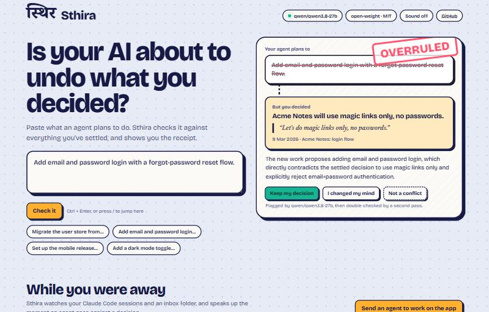

<div align="center">

# स्थिर · Sthira

**Your AI forgets what you decided. Sthira doesn’t.**

*sthira* (Sanskrit): steady, firm, unshakable.

[](https://github.com/HelloOjasMutreja/Sthira/actions/workflows/ci.yml) [](LICENSE) [](https://ollama.com/library/qwen3)

**[Live demo →](https://sthira-mocha.vercel.app)** · [How it learns](eval/README.md) · [Demo script](docs/DEMO_SCRIPT.md)

</div>

You make decisions across many conversations with AI: in ChatGPT, in Claude, in coding agents, in meetings. Weeks later an agent cheerfully undoes one of them, because nothing remembers *what was settled and why*.

Sthira reads your AI history, pulls out the **decisions** you made (with their reasons and a verbatim source quote), and keeps them in a local ledger. When new work contradicts a past decision, Sthira **warns you and cites where you decided it**. When it gets something wrong, you correct it, and **it learns**.

Everything runs on your machine with an **open-weight model** (Qwen3 via Ollama). No telemetry, no cloud.

```
$ sthira check "Migrate the user store from Postgres to MongoDB to avoid joins"

┌──────────────────────────────── ⚠ Sthira ────────────────────────────────┐
│ Contradicts a settled decision                                            │
│ Use Postgres, not MongoDB, for the user store.                            │
│ Decided 2026-03-04 in “Acme Notes: database choice”:                      │
│ “Ok, decided: we go with Postgres, not MongoDB. We need joins across      │
│  users, orgs and notebooks.”                                              │
└───────────────────────────────────────────────────────────────────────────┘
```

And in the app, the same moment: your agent's plan is struck through, **OVERRULED** is stamped on, and the decision you carved earlier rises with your own words.

<div align="center"></div>

## What it does

| | |
|---|---|
| **Reads your AI history** | ChatGPT and Claude.ai exports, Claude Code session logs (`~/.claude/projects`), meeting transcripts |
| **Keeps what you settled** | Decisions, open questions, preferences, commitments, lessons. Each has its reason, date and a verbatim quote, and the quote is verified against the source so hallucinated entries are dropped |
| **Never forgets history** | Nothing is deleted. A changed decision is *superseded*, so the old one stays with a link to its replacement |
| **Speaks up** | `sthira check`, `sthira scan <session>`, a Claude Code hook, and an MCP `check` tool give contradiction warnings that cite the source |
| **Learns from you** (self-correction) | Reject a bad extraction, or correct a wrong verdict. Your corrections become rules for every future run, and `sthira stats` shows precision before vs after |
| **Every agent sees it** | `sthira sync` writes a managed block into `AGENTS.md` / `CLAUDE.md` (or a Cursor rule), and the MCP server serves the ledger to any AI tool |
| **Works while you're away** | A background watcher reads new Claude Code sessions and an inbox folder, and raises an alert, with the agent's words and your decision side by side, the moment an agent goes against one |
| **A desktop app** | `sthira app` opens the whole thing in a native window: the check, the wall of decisions with a **Rewind** slider (what had you decided on any date?), a live alert feed and a reader that shows the model's progress and ETA while it imports |

## Proof that it learns

`sthira demo` runs a scripted end-to-end scenario on a realistic dataset ([`demo/`](demo/)), using a simulated reviewer that follows the gold labels in [`eval/gold.json`](eval/gold.json):

1. It reads a March ChatGPT export. With no corrections yet, it also logs personal chatter ("the kitten is named Miso") as decisions.
2. The reviewer settles the real decisions and rejects the rest, with a reason.
3. It reads a later export plus a meeting transcript. Extraction now applies the learned rules.
4. It scans today's Claude Code session, where the agent proposes migrating to MongoDB and adding password login. Sthira flags both, citing the March decisions.

On `qwen3:4b` on a laptop, extraction precision on unseen conversations rose from **0.60 to 0.71** after one round of corrections (recall 0.80). Contradiction checks went from 4/6 to **6/6** once the self-correcting critic pass was added. Full numbers, including a qwen3:8b comparison and the limits, are in [`eval/README.md`](eval/README.md).

## Quickstart

```bash
# needs uv (https://docs.astral.sh/uv/) and Ollama with a Qwen3 model
ollama pull qwen3:4b
git clone https://github.com/HelloOjasMutreja/Sthira && cd Sthira
uv sync

uv run sthira ingest path/to/chatgpt-export.zip      # or conversations.json, ~/.claude/projects/<proj>/, meeting.md
uv run sthira extract                                # the local open-weight model proposes entries
uv run sthira review                                 # settle or reject; rejections teach Sthira
uv run sthira check "Let's switch the user store to MongoDB"
uv run sthira scan ~/.claude/projects/<proj>/<session>.jsonl
uv run sthira sync AGENTS.md                         # every coding agent now sees what's settled
uv run sthira stats                                  # precision before vs after your corrections
uv run sthira demo                                   # the full scripted demo
uv run sthira watch                                  # keep the ledger current from new Claude Code sessions and ~/.sthira/inbox
```

### The desktop app
```bash
uv sync --extra desktop --extra web
uv run sthira app --demo        # a native window with the Acme Notes demo (press "Send an agent to work on the app")
uv run sthira app               # your own ledger, with the watcher running behind it
```
On Windows, `powershell -ExecutionPolicy Bypass -File scripts\launch-demo.ps1` starts a fresh demo every time. Add `-Local` to use your own Ollama instead of a hosted open-weight model.

### Inside Claude Code

**MCP server:** the agent can call `check` before acting, and `propose` when you decide something new.
```bash
claude mcp add sthira -s user -- uv run --no-sync --directory /path/to/Sthira --extra mcp sthira mcp
```
`--no-sync` matters: without it, `uv run` tries to update the environment first and fails if the desktop app has `sthira.exe` open, which shows up in Claude as "connection closed".

**Live guard:** add a `UserPromptSubmit` hook so Sthira warns you (and the agent) when a request contradicts a settled decision:
```json
{ "hooks": { "UserPromptSubmit": [ { "hooks": [ { "type": "command",
  "command": "uv run --no-sync --directory /path/to/Sthira sthira hook" } ] } ] } }
```

### Use another open-weight model or a hosted endpoint
```bash
STHIRA_MODEL=qwen3:8b sthira extract                               # bigger local model
STHIRA_PROVIDER=openai STHIRA_OPENAI_BASE_URL=https://… \
STHIRA_OPENAI_API_KEY=… STHIRA_MODEL=qwen/qwen3-32b sthira check "…"  # any OpenAI-compatible endpoint
```

## How it works

```
ChatGPT / Claude exports · Claude Code sessions · transcripts
        │  parsers → normalized messages (SQLite)
        ▼
 extract  ── open-weight LLM under a JSON schema → candidate entries
          ── verify quote exists in source (drops hallucinations) · dedupe
          ── your past corrections injected as rules  ◄──────────────┐
        ▼                                                             │
 ledger (SQLite + FTS5): proposed → settled / rejected → superseded   │
        │                                                             │
        ├─ check / scan / hook / MCP: retrieve related settled entries │
        │     → LLM judge → verdict + cited source                     │
        ├─ review: settle · reject (+why) · correct a verdict ────────┘
        └─ sync → AGENTS.md / CLAUDE.md
```

Design choices learned from the issue trackers of existing memory tools ([`docs/research/`](docs/research/)): extract only from raw messages (never from recalled memory), allow the extractor to return nothing, keep verbatim provenance, never delete, hold new entries as *quarantined* until a human confirms them (a defence against memory poisoning), and publish a reproducible eval instead of headline claims.

## Project

Built at **Hacktoberfest Hack Day Bengaluru 2026**: Track 2 (Best Open-Source AI Project), problem statement **O2, Adaptive AI with Memory and Self-Correction**. Team: Ojas Mutreja, Vidit, Danica.

Plan, interfaces and status: [`docs/PLAN.md`](docs/PLAN.md) · [`docs/CONTRACTS.md`](docs/CONTRACTS.md) · [`docs/STATUS.md`](docs/STATUS.md)

Contributions are welcome. New source parsers (Gemini, Cursor, Slack, Obsidian…) are small, self-contained files in `sthira/ingest/`.

## License
MIT
