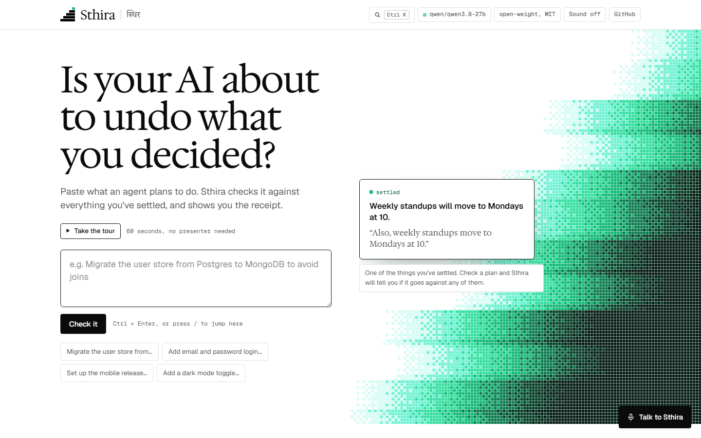

# Brand: settled strata

The look of the web and desktop UI (`web/static/index.html`). Read this before changing its colours, type or motion.

## The idea
Loose pixels resolve into solid bands, the way a decision settles into the ledger. That one picture carries the brand:

- **Strata** (the hero canvas). Bands of square cells that dissolve through an ordered dither. Green while everything is settled. They scan while a plan is checked, and turn orange and jolt when the plan goes against a decision. The pointer wipes pixels loose and they settle back.
- **The mark.** Five stepped bars, with the top one in green: the newest decision settling onto the stack.
- **The footer stack.** Orange blocks piled in the corner of a black ground.

## Tokens
All defined on `:root` at the top of the stylesheet. Use the variables, never raw hex.

| Role | Variable | Value |
|---|---|---|
| Ground, type | `--paper`, `--ink` | `#fff`, `#0b0b0c` |
| Quiet text, hairlines | `--ink-2`, `--line`, `--line-2` | `#5b605c`, `#dfe2dd`, `#c4c9c2` |
| Settled | `--mint`, `--jade`, `--jade-ink`, `--forest` | `#6ff2d2`, `#14b877`, `#0a6b47`, `#06301f` |
| Goes against a decision | `--madder`, `--madder-ink` | `#ff5a1f`, `#c23a08` |

Green means settled and orange means a contradiction. Don't use either as decoration.

## Type
- **Hedvig Letters Serif**: headlines, quotes (your exact words) and big numbers.
- **Geist**: everything you read or press.
- **Geist Mono**: ledger metadata only (dates, sources, locators, model names).
- **Tiro Devanagari Sanskrit**: स्थिर.

## Shape and motion
- Square world: 1px hairlines, 4 to 8px radii, no offset shadows. Primary buttons are solid ink.
- Motion is stepped (`steps()`), like the pixels. One orchestrated load, then motion only answers what the user did.
- `prefers-reduced-motion` gets a still frame of the strata and no entrance animation.

## Checks
The redesign was judged in real Chromium at 1440, 820 and 375px wide: no console errors, no horizontal overflow, and the strata holding 60 frames a second. Re-run those checks after any change to the hero.
